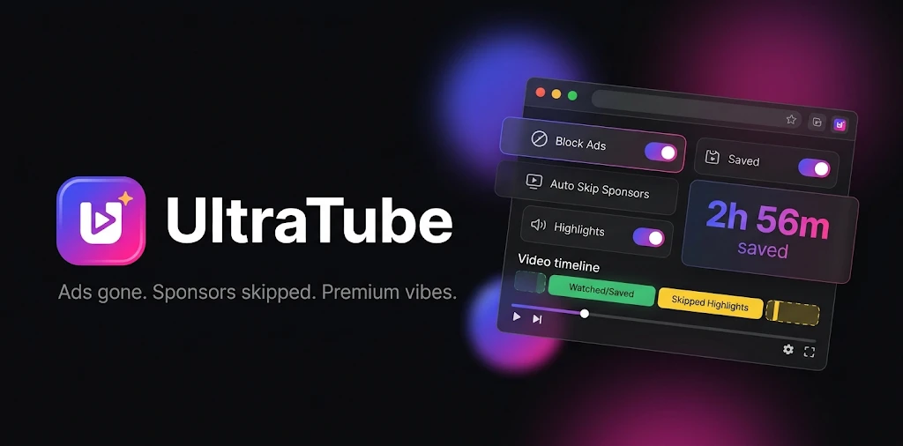
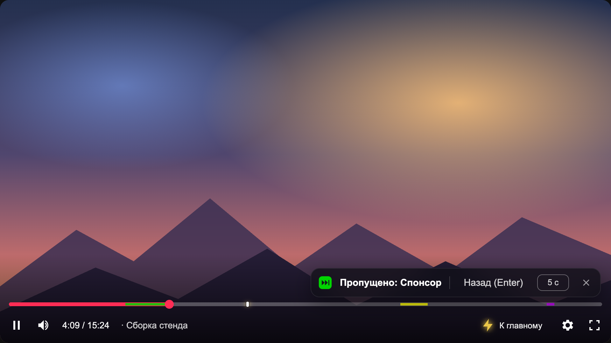
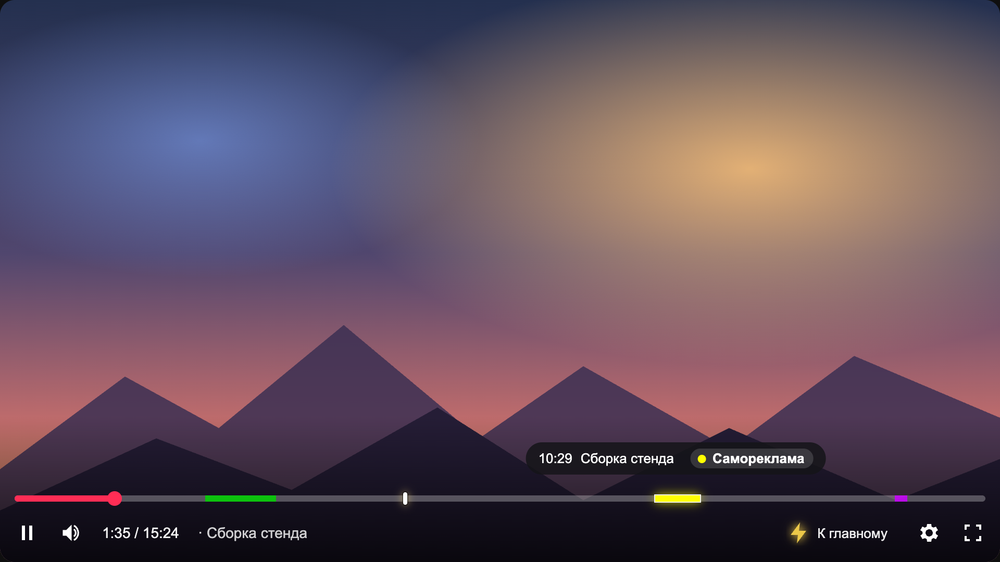
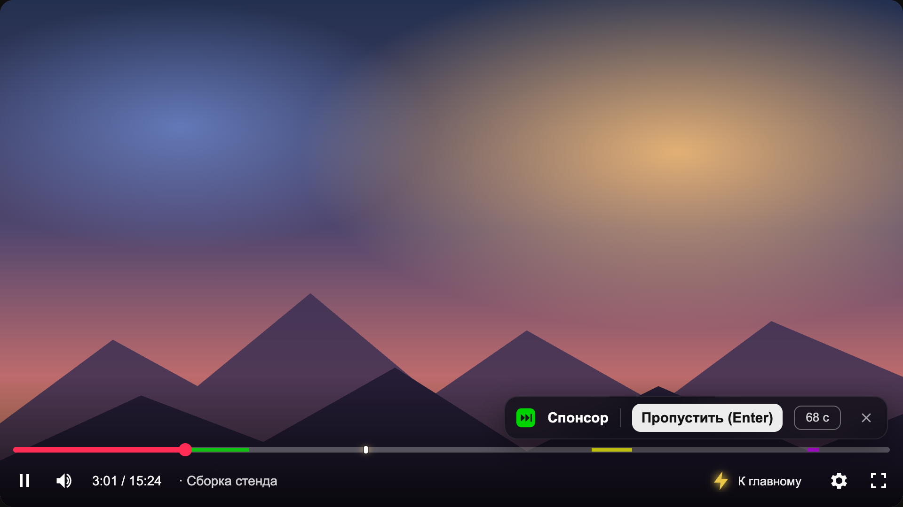
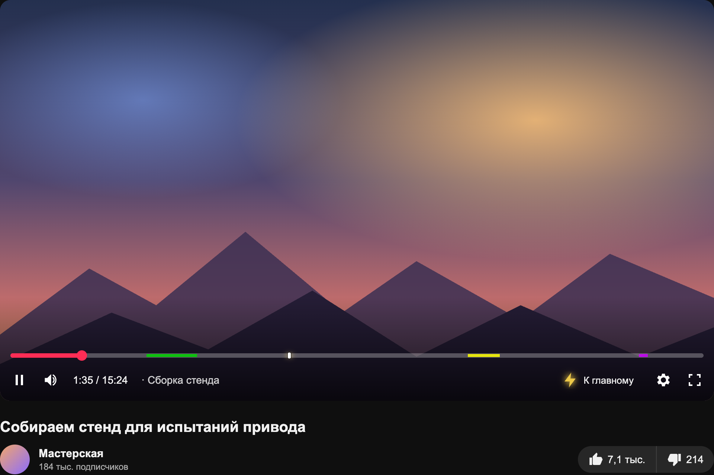
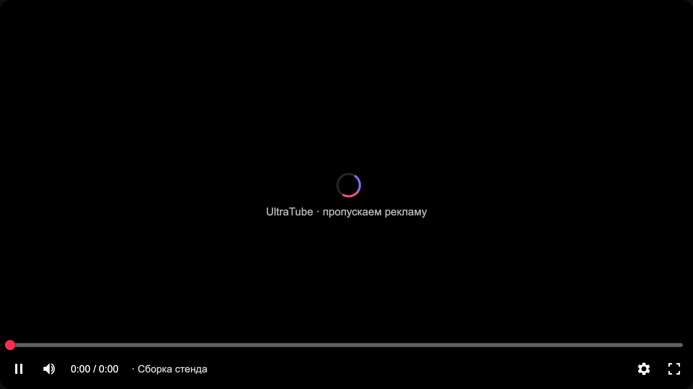
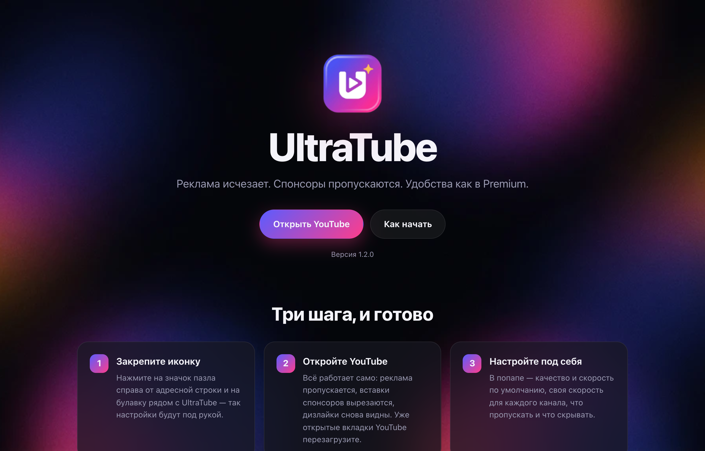
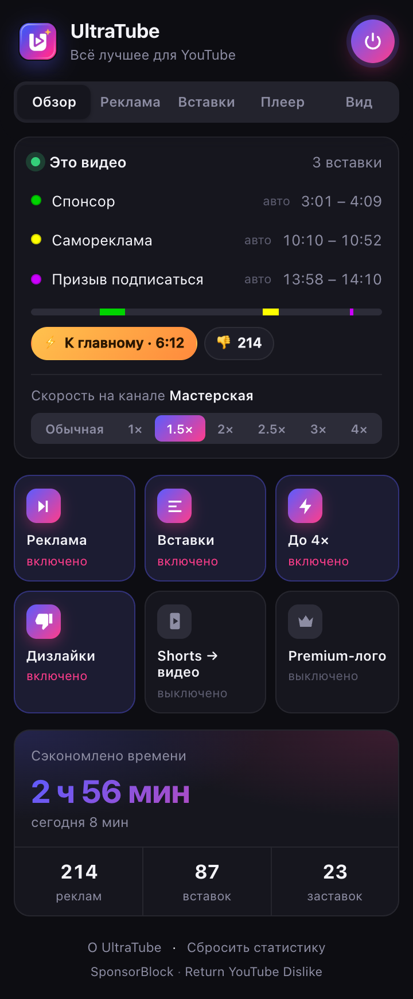
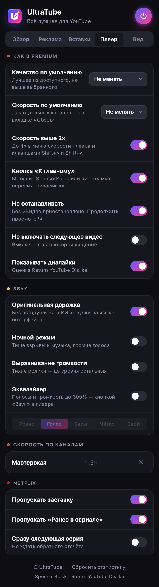
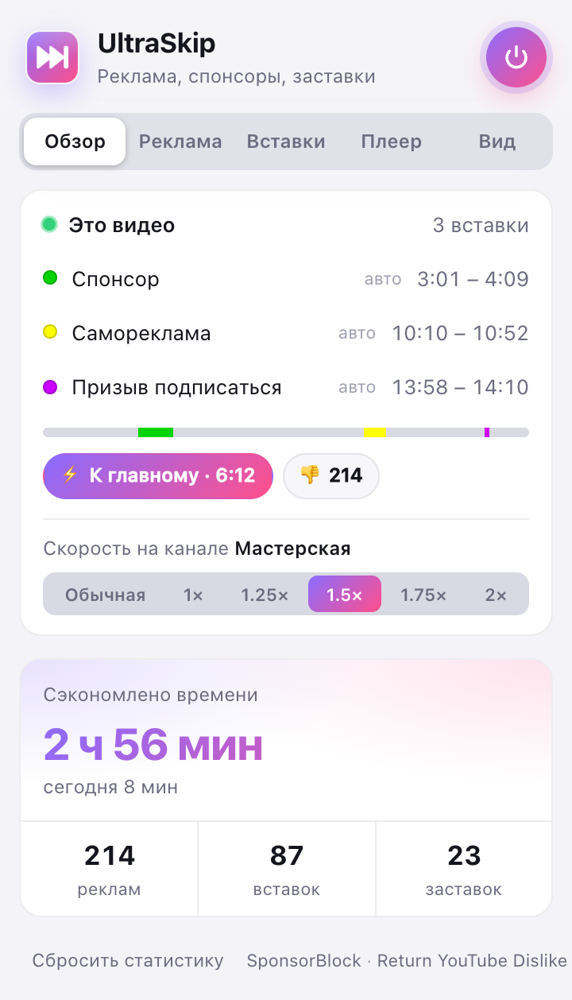

<p align="center">
  
</p>

<h1 align="center">UltraTube</h1>

<p align="center">
  Расширение для Chrome: пропускает рекламу YouTube и YouTube Music, вырезает спонсорские вставки, возвращает дизлайки<br>
  и добавляет удобства из Premium. Одно расширение вместо связки «пропуск рекламы + SponsorBlock + Return YouTube Dislike».
</p>

<p align="center">
  <a href="https://github.com/1magenative/ultratube/actions/workflows/test.yml"></a>
  
  
  <a href="LICENSE"></a>
</p>

<p align="center">
  
</p>

## Возможности

**Реклама YouTube**
- Реклама пропускается командой самого плеера сразу при появлении, даже до кнопки «Пропустить». На живом YouTube это занимает 0,1–0,3 с.
- Пропускаются все ролики в рекламном блоке («1 из 2», «2 из 2») и финальная заставка рекламы.
- Запасной путь: картинка закрыта, реклама идёт ×16 без звука, потом скорость и звук возвращаются.
- Скрываются рекламные карточки в ленте, поиске и под плеером; Shorts — по желанию. Сетка главной при этом перестраивается без пустых мест.

**Спонсорские вставки (SponsorBlock)**
- Таймкоды из открытой базы [SponsorBlock](https://sponsor.ajay.app): спонсор, самореклама, призыв подписаться, заставка, концовка и другие.
- Для каждой категории свой режим: **Авто** (пропустить), **Кнопка** (спросить, Enter — пропустить), **Метка** (только отрезок на полосе), **Выкл.**
- Цветные отрезки на полосе прогресса. При наведении категория дописывается прямо в подсказку YouTube.
- Уведомление справа снизу: «Пропущено: Спонсор · Назад (Enter) · 5 с».

**Как в Premium**
- **YouTube Music**: реклама пропускается так же, как на YouTube.
- **Скорость до 4×** прямо в меню скорости плеера: вместо кнопки «3,0» с отметкой Premium — ряд 2,5 · 3,0 · 3,5 · 4,0, «+» и «−» работают выше 2×, клавиши Shift+&gt; и Shift+&lt; тоже.
- **Shorts в обычном плеере** (по настройке): с перемоткой, скоростью и всеми функциями.
- **Качество по умолчанию**: максимум или потолок (4K, 1440p, 1080p, 720p, 480p).
- **Скорость по умолчанию** и **своя скорость для каждого канала**, прямо из попапа.
- **«К главному»**: кнопка в плеере и метка на полосе. Берётся метка «главное» из SponsorBlock, а если её нет — пик графика «самых пересматриваемых».
- **Не останавливать**: без «Видео приостановлено. Продолжить просмотр?».
- **Не включать следующее видео**: выключает автовоспроизведение.

**Дизлайки**
- Число дизлайков на кнопке под видео — оценка [Return YouTube Dislike](https://returnyoutubedislike.com).

**Без отвлекающего**
- Скрыть ленту на главной, рекомендации, комментарии, заставки и карточки поверх видео, Shorts — каждое отдельно.

**Логотип Premium**
- По желанию — надпись «Premium» у логотипа YouTube и YouTube Music. Только оформление: подписка от этого не появляется.

**Netflix**
- Пропуск заставки и «Ранее в сериале», по желанию — сразу следующая серия.

**Попап и страница приветствия**
- Быстрые переключатели в «Обзоре»: реклама, вставки, скорость до 4×, дизлайки, Shorts → видео, логотип Premium.
- Вкладки: Обзор · Реклама · Вставки · Плеер · Вид.
- В «Обзоре» — вставки текущего видео (клик — перейти к вставке), «К главному», дизлайки, скорость для канала, сэкономленное время.
- Светлая и тёмная тема.
- После установки открывается страница приветствия: что умеет расширение и как начать. Позже её можно открыть из попапа («О UltraTube»).

## Скриншоты

| Категория при наведении | Режим «Кнопка» |
|---|---|
|  |  |
| **«К главному» и дизлайки** | **Реклама закрыта, пока плеер её пропускает** |
|  |  |

<p align="center">
  
</p>

<p align="center">
  
  &nbsp;
  
  &nbsp;
  
</p>

> Скриншоты сняты с настоящим расширением на демо-странице плеера (`scripts/demo/player.html`), чтобы не публиковать чужие видео. Переснять: `npm run screenshots`.

## Установка

Расширения нет в Chrome Web Store, оно ставится вручную.

**Из релиза**
1. Скачайте `ultratube-<версия>.zip` на странице [Releases](https://github.com/1magenative/ultratube/releases) и распакуйте.
2. Откройте `chrome://extensions` и включите «Режим разработчика» справа вверху.
3. Нажмите «Загрузить распакованное» и выберите распакованную папку.

**Из исходников**
```bash
git clone https://github.com/1magenative/ultratube.git
```
Затем в `chrome://extensions` → «Загрузить распакованное» → папка `ultratube/extension`.

Если у вас стоят SponsorBlock или другие расширения для пропуска рекламы, отключите их, чтобы они не мешали друг другу. После обновления расширения перезагрузите открытые вкладки YouTube: если этого не сделать, попап покажет предупреждение.

## Как это работает

### Пропуск рекламы

YouTube игнорирует программные клики по кнопке «Пропустить» (проверяет `event.isTrusted`). Но сама кнопка лишь вызывает метод плеера `onAdUxClicked("skip-button", layoutId)`, и UltraTube вызывает его напрямую.

- Методы плеера доступны только из контекста страницы, поэтому этим занимается отдельный скрипт [`content/youtube-main.js`](extension/content/youtube-main.js) (`"world": "MAIN"`).
- Идентификаторы `layoutId` берутся из `getPlayerResponse()` и из всех ответов, которые получает страница: рекламу в середине видео YouTube догружает отдельным запросом. Плеер сам сверяет идентификаторы с текущей рекламой, чужие ни на что не влияют.
- Команда повторяется каждые 400 мс, пока реклама на экране.

Что пробовали и отказались, по замерам на живом YouTube:
- **Перемотка рекламы в конец:** если реклама ещё не загрузилась, плеер зависает и запускает ролик заново.
- **Прозрачное видео (`opacity: 0`):** YouTube медленнее переходит к следующему ролику, поэтому картинку закрывает слой поверх видео.

### Спонсорские вставки

- Сегменты запрашиваются по **первым 4 символам SHA-256 от ID видео**. Сервер возвращает все видео с таким префиксом, а нужное выбирается локально, так что SponsorBlock не узнаёт, что именно вы смотрите.
- После пропуска расширение отправляет анонимный счётчик просмотра сегмента (`viewedVideoSponsorTime`), как официальный клиент. Так авторы сегментов видят пользу от своей работы.

### Качество, скорость, «Не останавливать»

Методы плеера (`setPlaybackQualityRange`, `setPlaybackRate`, переключатель автовоспроизведения) вызывает тот же скрипт в контексте страницы. Настройки он получает от content-скрипта через атрибут `data-us-config` на `<html>`, а данные о канале отдаёт обратно в `data-us-channel`. Окно «Продолжить просмотр?» YouTube показывает по времени последнего действия пользователя (`window._lact`); расширение его обновляет, а если окно всё же появилось — подтверждает.

### Сетка главной без пустых мест

Главная — flex-сетка с переносом, а полки (Shorts и т. п.) идут на всю ширину. Если спрятать рекламную карточку, ряд перед полкой остаётся неполным. Поэтому, когда расширение что-то прячет, сетка переключается на CSS Grid с `grid-auto-flow: dense`: в пустое место подтягиваются следующие карточки, а полки по-прежнему занимают всю строку.

### Скорость выше 2×

Плеер YouTube держит свою скорость не выше 2× (3× у него — только для Premium), а сам `<video>` умеет до 16×. Расширение перехватывает кнопки скорости выше 2× (и любые кнопки, пока видео быстрее 2×: плеер считает, что стоит 2×, и «2,0» у него ничего бы не изменила), ставит скорость видео напрямую и показывает настоящее значение в панели и в меню.

### Устройство

```
extension/
  manifest.json            разрешения: storage + доступ к API SponsorBlock
  background.js            запросы к SponsorBlock и Return YouTube Dislike, кэш, статистика, бейдж
  shared/defaults.js       настройки по умолчанию, категории, форматирование времени
  content/youtube.js       реклама, вставки, «К главному», дизлайки, полоса, уведомления
  content/youtube-main.js  команды плеера: пропуск рекламы, качество, скорость, автовоспроизведение
  content/youtube.css      скрытие промо, Shorts и отвлекающего, стили отрезков и уведомлений
  content/netflix.js       кнопки Netflix
  popup/                   интерфейс расширения
  welcome/                 страница приветствия
```

## Приватность и разрешения

- `storage` — настройки и локальная статистика. Никуда не отправляются.
- Доступ к `sponsor.ajay.app` — запрос сегментов и анонимные счётчики пропусков.
- Доступ к `returnyoutubedislikeapi.com` — число дизлайков. Отправляется только ID открытого видео; отключается настройкой «Показывать дизлайки».
- Content-скрипты работают только на `youtube.com`, `music.youtube.com` и `netflix.com`. Доступа к вкладкам, истории и другим сайтам нет.
- Аналитики и сторонних серверов нет.

## Разработка

```bash
npm install
npx playwright install chromium
npm test              # 27 автотестов в Chromium с загруженным расширением
npm run screenshots   # переснять скриншоты для README
npm run pack          # собрать dist/ultratube-<версия>.zip для релиза
npm run icons         # нарезать иконки из docs/brand (фон убирается автоматически)
```

Тесты запускают настоящий Chromium с расширением на макетах YouTube и Netflix (`tests/fixtures/`). API SponsorBlock подменяется моком. Макет плеера ведёт себя как настоящий: принимает только «доверенные» клики и пропускает рекламу через `onAdUxClicked`.

Что проверяется:
- **реклама:** пропуск командой плеера (включая рекламу из отдельного запроса), запасной путь ×16, настройки по отдельности;
- **SponsorBlock:** приватный запрос, отрезки и подсказка, автопропуск с отменой по Enter, режимы «Кнопка» и «Метка», смена видео без перезагрузки;
- **плеер:** качество и скорость (общая и для канала), «К главному» из SponsorBlock и из графика, «Продолжить просмотр?», автовоспроизведение;
- дизлайки, скрытие ленты, рекомендаций, комментариев и карточек, сетка главной без дыр, логотип Premium, YouTube Music, Netflix;
- скорость выше 2× в панели и клавишами, Shorts в обычном плеере, страница приветствия, попап с вкладками и быстрыми переключателями.

Проверки на живом YouTube (с `HEADED=1` — в видимом окне):
- `node scripts/live-check.mjs <videoId> <секунда>` — пропуск вставки;
- `node scripts/live-hover.mjs <videoId>` — подпись при наведении;
- `node scripts/live-ads.mjs <videoId>` — реклама;
- `node scripts/live-features.mjs <videoId>` — качество, скорость, «К главному», дизлайки, автовоспроизведение, скрытие;
- `node scripts/live-logo.mjs` — логотип Premium на YouTube и YouTube Music (`LIGHT=1` — светлая тема);
- `node scripts/live-speed.mjs <videoId>` — скорость выше 2× в меню плеера и клавишами.

### Фирменный стиль

Исходники лежат в [`docs/brand/`](docs/brand): основная иконка, упрощённая для 16–32 px, баннер и фон страницы приветствия. Они сгенерированы в Nano Banana. Палитра: индиго `#5B5CFF` → маджента `#FF3D8B`, акцент `#FFC24D`. Для превью репозитория (Settings → Social preview) — [`social-preview.png`](docs/brand/social-preview.png): тот же баннер в PNG 1280×640, GitHub не принимает webp.

## Ограничения

- YouTube регулярно меняет плеер. Если что-то перестало работать, начните с селекторов в начале [`content/youtube.js`](extension/content/youtube.js) и с [`content/youtube-main.js`](extension/content/youtube-main.js).
- Расширение не блокирует сетевые запросы рекламы: реклама загружается, но пропускается.
- Блокировка и пропуск рекламы нарушают условия использования YouTube. Расширение предназначено для личного использования.

## Лицензия и благодарности

- Код распространяется по лицензии [MIT](LICENSE).
- Данные о сегментах — [SponsorBlock](https://sponsor.ajay.app) (лицензия [CC BY-NC-SA 4.0](https://creativecommons.org/licenses/by-nc-sa/4.0/)): источник указан в попапе, коммерческое использование данных запрещено.
- Дизлайки — [Return YouTube Dislike](https://returnyoutubedislike.com): это оценка по данным пользователей расширения и архивным данным, а не точное число YouTube.
- Проект не связан с YouTube, Google, Netflix или SponsorBlock.

---

<details>
<summary><b>In English</b></summary>

UltraTube (formerly UltraSkip) is a Manifest V3 Chrome extension that:
- skips YouTube ads instantly through the player's own `onAdUxClicked("skip-button", layoutId)` command, because YouTube ignores synthetic clicks; it falls back to ×16 muted playback behind a cover;
- skips sponsor segments using the [SponsorBlock](https://sponsor.ajay.app) database, with per-category modes (auto / ask / mark only / off), colored progress-bar segments and an undo toast;
- adds Premium-like conveniences: YouTube Music ad skip, speeds up to 4× right in the player's speed menu, default quality, default and per-channel speed, a "jump to highlight" button, no "Continue watching?" pauses, autoplay off, Shorts in the regular player;
- shows dislike counts from Return YouTube Dislike and can hide the home feed, recommendations, comments, end cards and Shorts without leaving gaps in the grid;
- can show a cosmetic "Premium" label next to the YouTube and YouTube Music logos;
- skips Netflix intros and recaps.

It looks up SponsorBlock segments by SHA-256 hash prefix, so the server never learns which video you watch. It has no analytics.

Install: download the release zip, or clone the repo, then use `chrome://extensions` → Developer mode → Load unpacked.

Run the tests with `npm install && npx playwright install chromium && npm test`.

The code is MIT-licensed. SponsorBlock data is CC BY-NC-SA 4.0.
</details>
